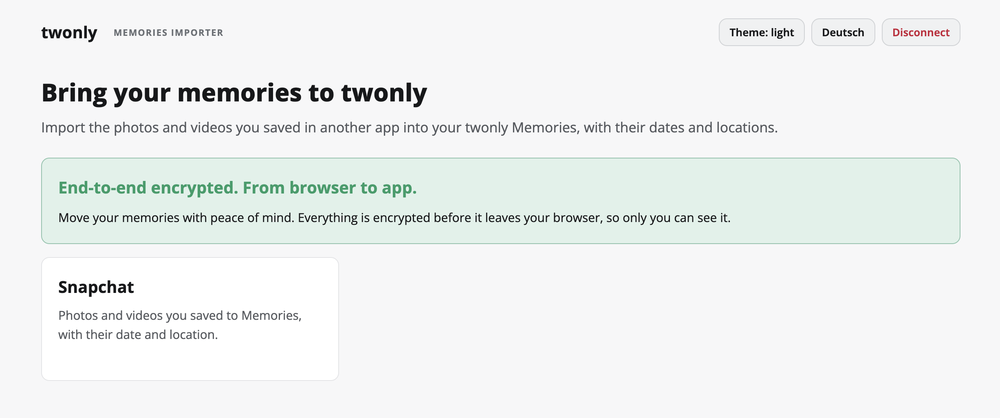
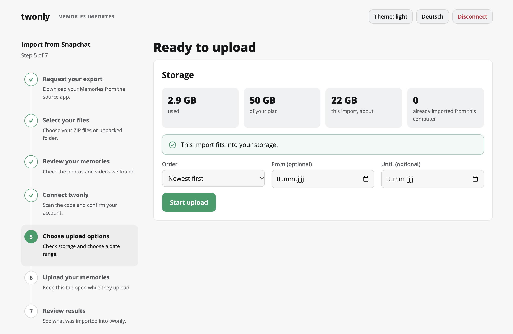

# twonly memories importer

Import Snapchat photos and videos into twonly Memories, keeping their dates
and locations.

[Open the importer](https://import.twonly.eu).

The page runs in your browser, in English or German. Memories are processed
and encrypted on your computer before upload. Only you can view them.

## What you need

- A twonly plan with Memories storage.
- Your Snapchat export as ZIP files or an unpacked folder. The page explains
  how to request it.
- A computer with Brave, Chrome, another Chromium browser, or Firefox.
  Safari cannot create the required WebP images.

## How it works

1. **Select your export** to preview its photos, videos, dates and locations
   before uploading.
2. **Connect your account:** scan the QR code with the twonly camera, tap
   "Connect" and confirm your username in the browser. The browser receives
   an encrypted key that only allows adding memories, never reading,
   changing or deleting existing ones. The server cannot open the key.
3. **Upload.** Photos become WebP images with captions and stickers included.
   Videos stay unchanged, without captions or stickers. You can pause,
   select a date range or upload newest first.
4. **Open twonly Memories** to see uploads as they arrive. Images may take
   a while to load.

To resume an interrupted upload, select the same export again. Already
uploaded memories are skipped.

